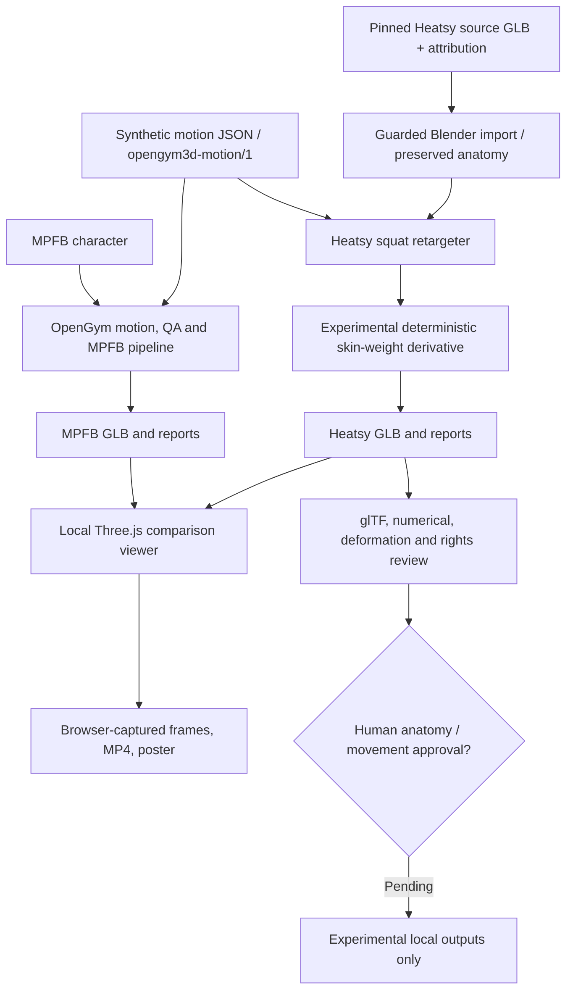
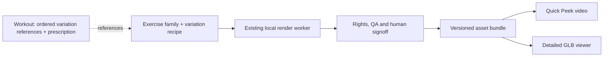

# System architecture | Actual boundaries and proposed seams

**Status:** Working local generation/inspection tools, **PARTIAL** animated Heatsy anatomical quality. This page describes what the repository currently implements, not a deployed service or approved instructional catalog. See [WORK](../knowledge/WORK.md).

## Existing architecture

## Implemented ownership boundaries

| Layer | Implementation | Responsibility | Must not own |
| --- | --- | --- | --- |
| Motion / canonical rig | `pipeline/motion.py`; `motions/synthetic/squat.json` | Normalized source, timing and canonical joint conventions | Content approval or display |
| MPFB generator and QA | `pipeline/build_exercise.py`, `pipeline/qa_glb.py`, `pipeline/validate_squat.py` | Existing MakeHuman route, GLB and structural/motion checks | Heatsy-only assumptions |
| Heatsy static compatibility | `studio/heatsy_patch.py`, `heatsy_roundtrip.py`, `heatsy_normals.py`, `heatsy_validate.py` | Pinned importer workaround, geometry/anatomy/normal preservation | Exercise technique |
| Heatsy animation and repair | `studio/heatsy_squat.py`; `studio/heatsy_repair.py` | Retarget the same motion; append tracked skin-weight derivative | UI, publication, generic authoring engine |
| Build and evidence | `studio/heatsy_repair_build.py`, `heatsy_repair_validate.py`, `heatsy_repair_blender.py`, `heatsy_repair_intersections.py` | Reproduce outputs, reject defects and retain measured evidence | Claiming medical/biomechanical approval |
| Browser and previews | `studio/heatsy-squat/viewer.js`, `studio/heatsy_squat_capture.mjs` | Orbit, synchronized playback, muscle selection, captured frames | Primary source or truth of motion |

All working proofs are local; output bundles go to ignored `outputs/` and source/model toolchains to ignored `work/`. The root MIT license covers the inherited project code; Heatsy-derived anatomy follows CC BY-SA 4.0 and required notices. Use [the repair report](../HEATSY_DEFORMATION_REPAIR.md) for exact preservation and performance evidence.

The bounded `studio/heatsy_attachment.py` experiment and its verifier/capture
reuse those boundaries and write only `outputs/heatsy-attachment/`. They separate
constant-weight contraction from spatial weight-gradient effects. The viewer's
allowlisted `repair=attachment-05` route exposes an **unapproved, non-promoted**
candidate; the previous repair remains unchanged. See [the attachment
report](../HEATSY_ATTACHMENT_REVIEW.md) for tradeoffs and native rest-matrix probes.

The separately authorized MPFB equipment-use proof introduces the bounded
[equipment-use contracts](EQUIPMENT-USE.md): standalone inspection, explicit
variation attachments and presentation guidance. It does not resolve Heatsy
deformation or approve exercise instruction. General articulated machines and
physics remain future work.

The equipment continuation reuses the same viewer and procedural builders for a
three-item inspection catalog. `equipment_catalog.py` can rebuild its static
assets and thumbnails without invoking an exercise build. `equipment_paths.py`
keeps continuation artifacts under `outputs/equipment-library/`; the checkpoint
proof remains read-only. Catalog and browser lifecycle gates complement the
existing exported-mesh contact validator. See the
[equipment architecture](EQUIPMENT-USE.md#initial-reusable-catalog) for ownership.

## Current limitations and non-goals

- Synthetic squat is an engineering fixture, **not** approved exercise instruction.
- Heatsy shoulder/back attachment, hip compression and knee attachments remain visually unacceptable. The latest repair deliberately exits **2** and fails strict Blender parity by a small margin.
- The standard GLB does **not** encode Blender's preserve-volume modifier; its diagnostic improvement is not an exported fix.
- Browser GPU profiling does not validate Android/iOS performance.
- There is no nontechnical exercise editor, workout composer, production publication pipeline, versioned release contract or Flutter consumer.

## Proposed future seams (not implemented)

**Exercise family** = squat; **variation** = bodyweight/goblet/dual-dumbbell technique; **workout** = a schedule or set/rep composition referencing variation IDs, not a new animation. Camera/muscle colors are presentation presets, not new techniques.

Future bundles should carry stable variation and model IDs, real animation duration/clip policy, muscles available on the selected character, equipment, preview URLs/relative paths, hashes, attribution, provenance, QA and human approval state. This contract is a proposal, not an existing API.

## Change rules

Change one boundary at a time. Keep OpenGym/MPFB and Heatsy paths separate, never degrade canonical assets to improve one experimental model, never remove anatomical identifiers for convenience, and retain failed evidence. For long-lived design choices create a short [ADR](DECISIONS.md); for the next experiment use [NEXT-SLICE](../plans/NEXT-SLICE.md).
